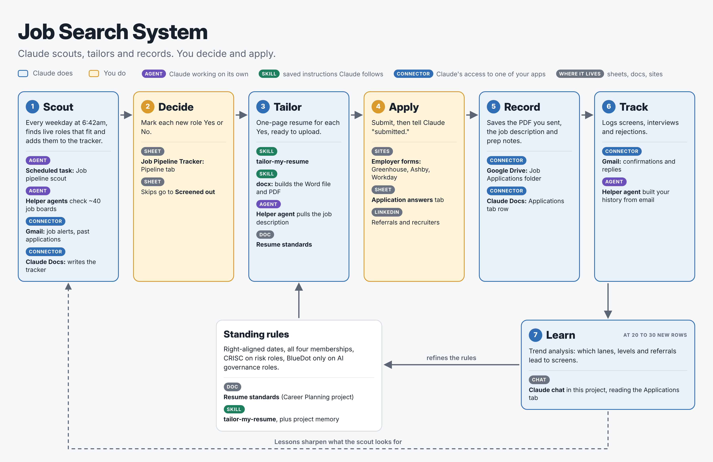

# Job Search System for Claude

A human-in-the-loop job search system built as a Claude plugin. Claude scouts roles, tailors resumes, and keeps the records. You make every decision and submit every application.

## Why I built it

I’m a former Army intelligence officer and solutions consultant who works across risk and controls, trust and safety, and responsible AI adoption & governance. My own job search had the usual problems: roles found too late or after they closed, resumes rewritten from scratch each time, and no reliable record of what I sent where. I built this system in Claude to fix that, and to practice what I advise organizations to do with AI: give agents clear rules, keep people at the decision points, and keep a record of what happened.

## How it works

| Step | Who | What happens | Built with |
|---|---|---|---|
| 1. Scout | Claude | Weekday mornings, checks employer job boards and job alerts, and adds roles that pass your filters to the Pipeline tab with honest fit notes | Scheduled task (agent), helper agents, Gmail connector |
| 2. Decide | You | Mark each role Yes or No | Tracker spreadsheet |
| 3. Tailor | Claude | One accurate, one-page resume per Yes, plus an apply/skip call and the gaps to expect | `tailor-resume` skill, docx skill |
| 4. Apply | You | Submit on the employer's site, then tell Claude "submitted" | Employer site |
| 5. Record | Claude | Saves the exact PDF sent and the job description, and logs the application | `log-application` skill, Google Drive connector |
| 6. Track | Claude | Updates stages and outcomes from your email | Gmail connector |
| 7. Learn | Claude, with you | Finds what leads to screens and proposes changes to targeting and resume rules | `analyze` skill |

## Design choices

- **People decide.** Claude never applies, signs in to job sites, or contacts anyone. You choose every role and submit every application.
- **Live postings only.** The scout confirms each role on the employer's own job board. Aggregator listings are leads, not proof a job is open.
- **Honesty guardrails.** Your profile records what a resume must never claim and the exact wording for sensitive items. Every claim must trace to your real experience.
- **Rules that improve.** Corrections become standing rules in your profile, and the analyze step proposes changes backed by your own outcomes.
- **A record for every application.** When a recruiter calls weeks later, the posting and the exact resume you sent are one click away, even if the posting has been taken down.

## Install

Requirements: a paid Claude plan with Cowork or Claude Code, plus Gmail. Google Drive and Claude Sheets are recommended.

1. In Claude, open **Plugins**, choose **Add marketplace**, and enter `https://github.com/cyberandy-code/job-search-system`. In Claude Code: `claude plugin marketplace add cyberandy-code/job-search-system`.
2. Install **job-search-system**. In Claude Code you can do both steps at once: `/plugin install job-search-system --marketplace cyberandy-code/job-search-system`.
3. Run `/setup` and upload your resume. Setup interviews you, connects your apps, and creates your profile, tracker, and daily scout.

## Skills

| Skill | Use |
|---|---|
| `/setup` | First run: profile, tracker, connectors, daily scout |
| `/scout` | Find and add live roles that fit |
| `/tailor-resume` | Apply/skip call and a tailored resume for one posting |
| `/log-application` | Record a submission, or update a stage or outcome |
| `/analyze` | Trends in what leads to screens, with recommended changes |

## Privacy

Your profile, tracker, and application records live in your own Claude workspace and Google Drive. The plugin contains no personal data. Gmail is used to read job alerts and application emails; the system never sends email.

## License

MIT
